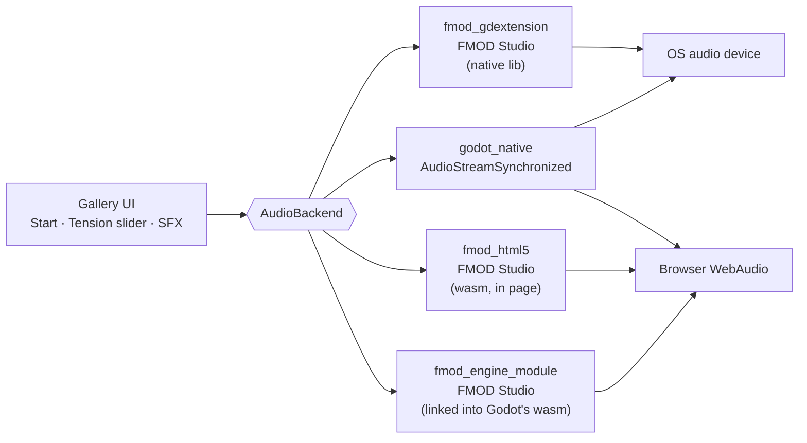

# Adaptive Audio Gallery (Godot 4.8)

Demos of the different ways to get **adaptive (interactive) audio** into a Godot game, with a focus on what still works
in a **web export**. Every prototype drives the same small demo through the same UI, so you can compare them directly:

- **Music:** two sample-aligned loops, *calm* and *action*. A `Tension` parameter (0–1) crossfades between them. This is
  called *vertical layering*.
- **SFX:** one-shots that pick a random variation and vary their pitch slightly each time (`click`, `footstep`).



## Prototypes

| Prototype                                                   | Technique                                                                    | Platforms     | Run                                          | Status                            |
|-------------------------------------------------------------|------------------------------------------------------------------------------|---------------|----------------------------------------------|-----------------------------------|
| [FMOD gdextension](docs/prototypes/fmod-gdextension.md)     | FMOD Studio banks through the `fmod-gdextension` addon                       | Desktop       | `task run:fmod-gdextension`                      | Works (desktop reference)         |
| [FMOD HTML5 SDK](docs/prototypes/fmod-html5.md)             | FMOD's own HTML5/wasm runtime in the page, called through `JavaScriptBridge` | Web           | `task run:web:fmod-html5`                        | Works (tested in Firefox desktop) |
| [Godot native](docs/prototypes/godot-native.md)             | `AudioStreamSynchronized` + `AudioStreamRandomizer`, no FMOD                 | Desktop + Web | `task run:godot-native`, `task run:web:godot-native` | Works                             |
| [FMOD engine module](docs/prototypes/fmod-engine-module.md) | Our own engine module links FMOD's static wasm library into custom Godot web templates | Web | `task run:web:fmod-engine-module` | Works (music verified by listening; SFX fix awaiting re-listen) |

`task run` opens the desktop launcher, where you can pick a prototype from a dropdown. `task check` runs a headless
smoke test of every prototype that is available on desktop.

## Quick start

Prerequisites:

- **Godot 4.8.dev7**, as `godot` on your `PATH` (e.g. through gdvm), with web export templates installed. To use a
  different binary, run `GODOT=/path/to/godot task …`.
- **[Task](https://taskfile.dev)** (`go-task`). If it isn't installed, `npx @go-task/cli <task>` works too.
- **Python 3**, used as the static file server for web builds.
- **FMOD HTML5 SDK 2.03.x** (`fmodstudioapi20315html5.zip` from fmod.com). It is only needed for `web:fmod-html5`. Put
  it in `fmod/`, or set `FMOD_HTML5_SDK=/path/to/zip`. Its licence doesn't allow committing it, so `fmod/` is
  gitignored.
- **Only for the engine-module prototype:** [uv](https://docs.astral.sh/uv/), Emscripten 6.0.1+ and git. uv provides SCons in a project-local venv (`engine/.venv`, pinned by `engine/uv.lock`), so nothing is installed system-wide. Run `task tools:check` to see what's
  missing. The first `task run:web:fmod-engine-module` fetches the Godot source (about 430 MB, gitignored in
  `engine/godot/`) and builds the web template, which takes roughly 10–20 minutes.
- The desktop FMOD runtime ships inside `addons/fmod/` (fmod-gdextension 6.1.0, FMOD 2.03.6).

```sh
task import            # once after cloning
task check             # headless: prints one [check] line per desktop prototype
task run:godot-native  # desktop window, Godot audio
task run:web:fmod-html5 # export + serve on http://localhost:8060 (PORT=… to change)
```

In the window: press **Start music**, drag **Tension**, then press **Click** or **Footstep**. In browsers, the first
click also unlocks audio.

## Repository layout

```
gallery/               launcher scene + prototype registry (gallery.gd)
prototypes/
  audio_backend.gd     AudioBackend: the contract every prototype implements
  fmod_gdextension/    FMOD via the native addon
  fmod_html5/          FMOD via the HTML5 SDK; web/fmod_bridge.js is copied next to index.html
  godot_native/        Godot's built-in audio
audio/                 source loops and SFX (used by godot_native)
banks/                 FMOD banks built from fmod-studio/ (used by both FMOD prototypes)
fmod-studio/           FMOD Studio 2.03.15 project that produces the banks
engine/modules/        our fmod_studio engine module (C++), built into custom web templates
engine/godot/          Godot source checkout for the template build (gitignored, fetched by task)
addons/fmod/           fmod-gdextension addon (desktop libraries)
export_presets.cfg     "Web" (Godot audio) and "Web FMOD HTML5" presets
Taskfile.yaml          one task per prototype, plus export/check/banks
docs/                  architecture, one page per prototype, bank guide, audio credits
```

## Docs

- [Architecture](docs/architecture.md): the backend contract, how a prototype is selected, the web build pipeline, and
  how to add a prototype.

Prototypes: [FMOD gdextension](docs/prototypes/fmod-gdextension.md) · [FMOD HTML5 SDK](docs/prototypes/fmod-html5.md) · [Godot native](docs/prototypes/godot-native.md) · [FMOD engine module](docs/prototypes/fmod-engine-module.md)

- [FMOD Studio bank guide](docs/fmod-studio-bank-guide.md): how the banks were built, and how to rebuild them.
- [Audio sources](docs/audio-sources.md): licences of the bundled audio, and candidate material for new demos.

## Findings so far

|                     | FMOD gdextension                 | FMOD HTML5 SDK                     | FMOD engine module                 | Godot native           |
|---------------------|----------------------------------|------------------------------------|------------------------------------|------------------------|
| Desktop             | ✅                               | –                                  | – (web-only module)                | ✅                     |
| Web                 | ❌ no GDExtension support on web | ✅ official templates               | ✅ custom template                  | ✅ official templates   |
| Authoring           | FMOD Studio                      | FMOD Studio (same banks)           | FMOD Studio (same banks)           | Code / Godot resources |
| GDScript → FMOD     | native singleton                 | `JavaScriptBridge` strings          | native singleton                   | –                      |
| Web `index.wasm`    | –                                | 38.6 MB + 2.8 MB FMOD js/wasm      | 38.6 MB (FMOD inside, ~1.1 MB of it) | 38.6 MB                |
| Web `index.pck`     | –                                | 20.1 MB (incl. 5.5 MB bank)        | 20.1 MB (incl. 5.5 MB bank)        | 14.6 MB                |
| Build cost          | –                                | unzip SDK files                    | ~10–20 min template build per engine update | –          |

Sizes are uncompressed. Mobile browsers have not been tested, since mobile isn't a target for now.
