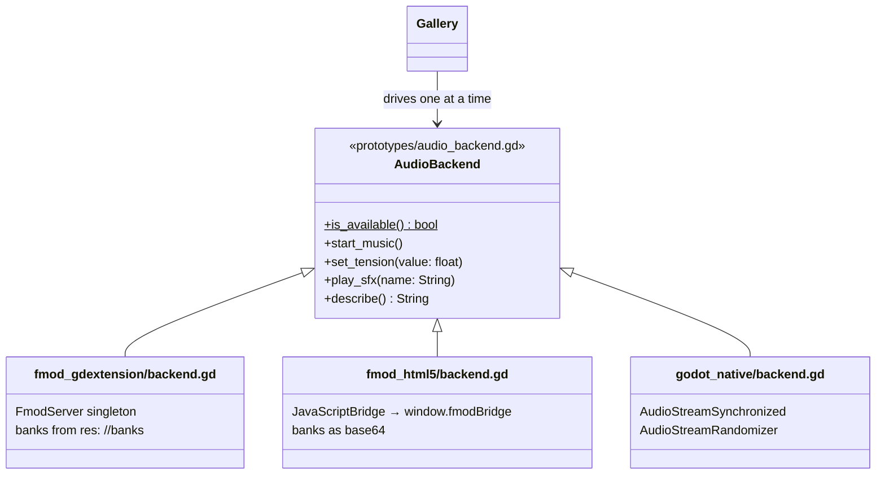
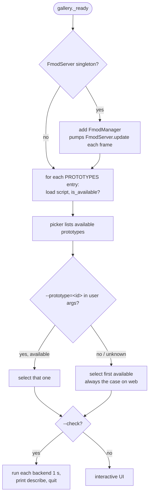
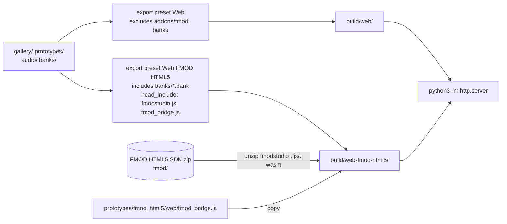

# Architecture

There is one scene (`gallery/main.tscn`) and one UI. Each prototype is a single `AudioBackend` node that the gallery
swaps in and out. The UI only knows the four methods of the contract. Everything engine-specific stays inside a
prototype's folder.

## The contract

| Method                    | Meaning                                                                                                                                                                                                                         |
|---------------------------|---------------------------------------------------------------------------------------------------------------------------------------------------------------------------------------------------------------------------------|
| `is_available()` (static) | Whether the backend can run in this build. The gallery calls it on the script before instancing it, so a missing FMOD singleton or a missing JS bridge never causes an error.                                                   |
| `start_music()`           | Starts the adaptive music event. It is called from a button press, which is also the user gesture browsers require before they play audio.                                                                                      |
| `set_tension(v)`          | The adaptive parameter, 0 = calm, 1 = action. Smoothing is up to the backend: `godot_native` uses `move_toward` at 2/s. The FMOD backends rely on the parameter's seek speed in Studio, which is currently unset, so they snap. |
| `play_sfx(name)`          | Plays a one-shot: `click` or `footstep`.                                                                                                                                                                                        |
| `describe()`              | One line of verifiable state, printed by the headless smoke test.                                                                                                                                                               |

Backends reach engine-specific APIs only through `Engine.get_singleton(...)` or `JavaScriptBridge`. Because of that,
every script parses on every platform, and the web builds start cleanly even though `addons/fmod` is excluded from them.

## Selecting a prototype

`FmodManager` lives in the gallery rather than in the FMOD backend. When you switch away from FMOD, the backend's
`stop()` is only queued, and it takes effect on the next `FmodServer.update()`. The manager has to outlive the backend
so that update still happens.

## Web build pipeline

Both presets use the official templates in single-threaded mode with no GDExtension support. That means no cross-origin
isolation headers (COOP/COEP) are needed, and any static file server works. Task's `sources`/`generates` skip the export
when no input has changed.

## Import hygiene

Godot imports every folder that lacks a `.gdignore`. These folders carry a committed `.gdignore`:

- `build/`: export output
- `fmod/`: the proprietary SDK
- `fmod-studio/`: FMOD Studio's own copies of the audio
- `prototypes/fmod_html5/web/`: plain JS, not a Godot resource

## Adding a prototype

1. Create `prototypes/<id>/backend.gd` with `extends AudioBackend`, and implement the four methods plus `is_available()`
   if the backend is platform-specific.
2. Add one entry `{id, title, script}` to `PROTOTYPES` in `gallery/gallery.gd`. The order sets the default.
3. Add a `task <id>` (or `web:<id>`) to `Taskfile.yaml`. A web prototype that needs page-side JS gets its own export
   preset with `html/head_include`, plus an export task that copies the JS next to `index.html`.
4. Write `docs/prototypes/<id>.md` with a diagram, and add a row to the README table.

If a new demo needs a different adaptive technique, such as horizontal re-sequencing or stingers, extend the contract
with that method, and keep it to what the UI actually calls.
