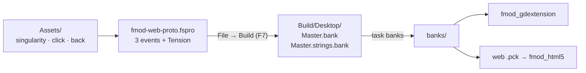

# FMOD Studio bank guide

The steps below rebuild `banks/Master.bank` and `banks/Master.strings.bank` from the Studio project in `fmod-studio/fmod-web-proto/fmod-web-proto.fspro`. Both FMOD prototypes load these same banks: the desktop gdextension and the HTML5 SDK.

Tool: **FMOD Studio 2.03.15**. Menu names follow the 2.03 docs. If a menu has moved in your version, the concept is still the same.

## What the project contains

| Event | Content |
|---|---|
| `event:/Music/Adaptive` | 2D timeline with two audio tracks, `calm` (`singularity_calm`) and `tense` (`singularity_action`), both starting at 0:00 inside one loop region. A parameter sheet for **`Tension`** automates the volumes: calm goes from 0 dB at 0 to -inf at 1, tense does the reverse. |
| `event:/SFX/Click` | One-shot, a single sample (`click_001`) |
| `event:/SFX/Footstep` | One-shot multi instrument with the four Kenney `back_00x` sounds and a random pitch modulator |

**`Tension` parameter:** a preset in the Preset Browser. Type *User: Continuous*, range 0–1, initial value 0, scope **local**, because it belongs to the event instance and the game sets it per instance. The project currently sets **no seek speed**, so value jumps snap. Setting one (e.g. 2/s, which `godot_native` emulates) makes slider jumps fade.

## Rebuilding

1. Open `fmod-studio/fmod-web-proto/fmod-web-proto.fspro` in Studio.
2. Keep **Desktop** as the only platform. Studio has no HTML5 build platform, and the HTML5 runtime loads Desktop banks.
3. Keep the encoding at **Vorbis** (the project default) or FADPCM. The HTML5 runtime decodes only Vorbis, FADPCM, and PCM, so never use Opus.
4. Make sure all three events are assigned to the **Master** bank. `Master.strings.bank` is generated automatically, and the game needs it to find events by path.
5. **File → Build** (F7). The output goes to `fmod-studio/fmod-web-proto/Build/Desktop/`.
6. Run `task banks` to copy the result into `banks/`. Godot only sees `banks/`, because `fmod-studio/` has a `.gdignore`.
7. Check: `task check` should report `=true` for all three event paths.

## Building a new event from scratch (short version)

1. **Events browser** → New Folder → **New Event → 2D Timeline**.
2. Drag assets from the **Assets browser** onto tracks at 0:00. For layered music, every layer must have the same length and tempo.
3. For music: right-click the logic track → **Add Loop Region**, spanning the instruments exactly.
4. **+** next to the *Timeline* tab → **Add Parameter Sheet** → pick or create the parameter.
5. Select a track. In the deck, right-click **Volume** → **Add Automation**, then draw the curve on the parameter sheet. Bending the curve toward equal power is optional.
6. Press Play in Studio and drag the parameter. The mix should change smoothly without restarting the loop.
7. Assign the event to a bank, then build.

## Checklist

- [ ] `Tension` changes the mix audibly in Studio
- [ ] The loop has no gap or click at the loop point
- [ ] `Footstep` sounds different on repeated plays
- [ ] The banks are built for Desktop with Vorbis or FADPCM, and copied with `task banks`

## Versions

Banks built with Studio 2.03.15 load in the desktop runtime 2.03.6 (verified) and in the HTML5 SDK 2.03.15. FMOD staff say banks are compatible across patch versions. If the desktop runtime reports `ERR_VERSION`, update the libraries in `addons/fmod/` to match Studio.
