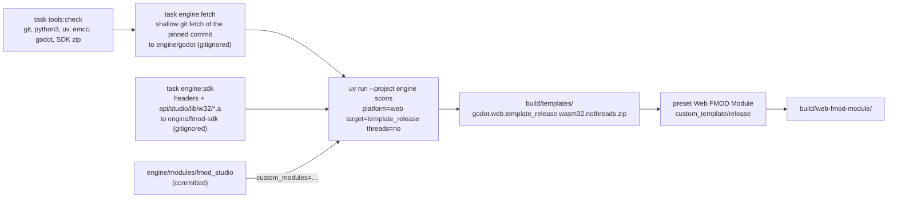
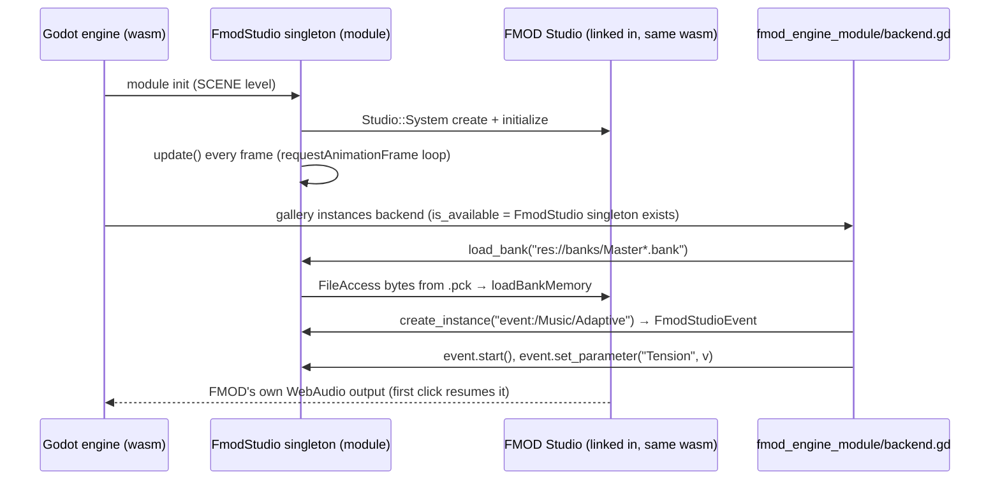

# FMOD engine module (web, custom templates)

`engine/modules/fmod_studio/` + `prototypes/fmod_engine_module/backend.gd` · run with `task run:web:fmod-engine-module`

This prototype compiles FMOD Studio **into the Godot engine**. Our own small module links the FMOD HTML5 SDK's static
wasm library (`fmodstudio_wasm.a`) into a custom web export template. FMOD then runs inside Godot's own wasm: there is
no second runtime in the page, no JavaScript bridge, and GDScript calls a native singleton, `FmodStudio`, just like on
desktop.

It does not use the third-party fmod-gdextension fork. The module is about 200 lines of C++ that expose only what the
gallery needs.

## Build pipeline

- SCons comes from the uv project in `engine/` (`pyproject.toml` + `uv.lock`). `uv run` creates `engine/.venv`, which
  is gitignored, on first use, so no system-wide install is needed.
- The Godot checkout stays **unmodified**. The module is added with SCons' `custom_modules` option, so the change to
  the engine is "one more module", not a patch.
- The commit is pinned to `c971f93e7`, the commit the 4.8.dev7 editor was built from. An export template has to come
  from the same commit as the editor that exports with it, and `tools:check` verifies this.
- Only the release template is built. `--export-release` needs nothing else, and building the debug template too would
  double the build time.
- `engine:build` has `sources: engine/modules/**`, so it only rebuilds when the module or the SDK changes.

## Runtime

## Module API

| `FmodStudio` (singleton) | |
|---|---|
| `load_bank(path) -> bool` | Reads the file through `FileAccess`, so `res://` inside the `.pck` works, then calls `loadBankMemory` |
| `has_event(path) -> bool` | Checks whether the path resolves (used by the smoke test) |
| `get_instance_count(path) -> int` | Live instances of an event. The smoke test uses it to see that one-shots are still playing |
| `create_instance(path) -> FmodStudioEvent` | One event instance |
| `play_one_shot(path)` | Fire-and-forget: `start()` then `release()`, with no `FmodStudioEvent` wrapper, because the wrapper's destructor would stop the sound immediately |
| `is_initialized()`, `get_last_error()` | Diagnostics |

| `FmodStudioEvent` (RefCounted) | |
|---|---|
| `start()`, `stop(allow_fadeout = true)` | |
| `set_parameter(name, value)`, `get_parameter(name)` | |
| `get_playback_state() -> int` | `FMOD_STUDIO_PLAYBACK_STATE` |

When the last reference to an `FmodStudioEvent` goes away, the instance stops and is released. The backend's music
therefore stops by itself when the gallery switches to another prototype.

## Design notes

- **The update pump lives in C++.** Studio commands (start, stop, parameters) are only processed in
  `System::update()`. The module drives it from a requestAnimationFrame loop by default, or a timer with
  `?fmod_update=<ms>`, the same way the `fmod_html5` bridge does, so the two web FMOD prototypes stay comparable. The
  loop runs outside the SceneTree, so it keeps going after a backend node is freed. That's the same reason the
  gdextension prototype keeps `FmodManager` in the gallery.
- **Link settings go in `config.py` `configure()`, not in `SCsub`.** `platform/web/SCsub` runs before `modules/SCsub`
  and freezes `EXPORTED_RUNTIME_METHODS` into a single `-s` flag. The FMOD docs require
  `ccall,cwrap,setValue,getValue`, so the module appends them, and the static library, during `configure()`.
- **`can_build` returns true only for `web`.** The module never affects desktop builds. On desktop, the
  [gdextension prototype](fmod-gdextension.md) covers FMOD.
- **The library is non-pthread and "reduced".** `fmodstudio_wasm.a` contains the reduced core, so it can't use
  `.ogg`/`.mp3` through the core API. Studio banks (Vorbis/FADPCM) are fine. `fmodstudioL_wasm.a`, the logging and
  full-core build, is selected automatically for non-release targets.
- **The toolchains differ.** FMOD 2.03.15 is compiled with Emscripten 3.1.67, while Godot 4.8 needs Emscripten 6.0.1
  or newer. A standalone test, which linked `fmodstudio_wasm.a` with Godot's link flags under Emscripten 6.0.10 and
  played the bank in Chromium, showed that the static library still links and runs.

## Latency settings (URL parameters)

FMOD's output buffer and the `System::update()` cadence can be changed per page load, so you can compare them by ear
in two tabs without rebuilding:

| Parameter | Values | Default |
|---|---|---|
| `fmod_buffer` | `<length>x<count>`, e.g. `1024x4`, `2048x2` | `512x4`, about 43 ms, the same as the desktop gdextension |
| `fmod_update` | milliseconds, or `frame` (requestAnimationFrame) | `frame` |

The defaults were 2048×2 (about 85 ms, the FMOD HTML5 docs' advice against WebAudio underruns) and 20 ms, and the
click and footstep lagged audibly behind the Godot-native version. In the listening test, 512×4 + `frame` sounded
better. The trade-off: FMOD and Godot share the browser's main thread here, so the buffer is the cushion against frame
stalls. About 43 ms covers 2–3 frames at 60 fps. If a heavier game shows dropouts during loads or on slow devices, try
`1024x4` first, then `2048x2`. In background tabs `frame` updates pause, so new commands wait until the tab is visible;
music that is already playing continues.

Example of the old, safer setting: `http://localhost:8060/?fmod_buffer=2048x2&fmod_update=20`. The values FMOD actually uses are printed to the browser console
and included in `describe()`, e.g. `dsp=512x4 (43 ms) rate=48000 update=every frame`. Invalid values fall back to the
defaults. Smaller buffers lower the latency but can crackle on slow devices.

## Results

Verified on 2026-10-05:

- **Build:** a clean build has not been timed. The first run stopped early on a compile error; the run that
  continued from it took 9:54 at `-j10` on 12 cores, so expect roughly 10–20 minutes from scratch. After a change to
  the module, only the module is recompiled and the engine relinked, which takes 1:44. A no-op run takes 9 s. The
  template zip is 10.3 MB.
- **Headless Chromium:** the gallery's `--check`, passed as an engine argument, runs inside the web build:
  `FmodStudio: initialized`, both banks load from the `.pck`, all three event paths resolve, the music instance is
  playing (`state=0`), and `Tension` reads back as 0.70. There are no errors from the module. The leak warnings at
  exit also appear with the official templates.
- **Size (uncompressed):** `index.wasm` 38.6 MB with FMOD inside. FMOD's own share is about 1.1 MB: a standalone
  test program linking only `fmodstudio_wasm.a` came to 1.1 MB. That the total matches the official template is a
  coincidence of build settings, since the official templates are built with `production=yes` (thin LTO) and
  Emscripten 6.0.1, while ours uses defaults and 6.0.10. `index.pck` 20.1 MB, including the 5.5 MB bank. There are no extra files: compared to the
  [HTML5 SDK prototype](fmod-html5.md), the 2.8 MB `fmodstudio.js`/`.wasm` and the bridge are gone.
- **Audio unlock:** works. In the listening test, the music started after the first click with no extra code, so
  FMOD's own WebAudio output resumes its AudioContext on the user gesture, as it does in the HTML5 SDK build.
- **Listening test (user):** the music blend works. The SFX were silent at first, because `play_one_shot` wrapped the
  instance in an `FmodStudioEvent`, and that object's destructor stopped the sound in the same tick. This is now fixed,
  and the browser `--check` sees both one-shots playing (`sfx_instances(Click=1, Footstep=1)`). Re-listen to confirm.

## Limitations

- Building the custom template takes a long time, and it has to be rebuilt for every engine update, because the
  template must match the editor's commit.
- FMOD and Godot still use separate WebAudio contexts, so there is no shared mix with Godot's own buses.
- The module covers only the gallery contract. Callbacks, buses, VCAs, snapshots and 3D attributes are not exposed;
  add them when a demo needs them.
