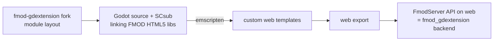

# FMOD engine module (postponed)

Status: **not implemented**. There is no task for it.

The idea is to compile FMOD into the engine as a module, using the [sphynx-owner fork of fmod-gdextension](https://github.com/sphynx-owner/fmod-gdextension/tree/godot-module-restructure) (written against FMOD 2.03.11), and to build **custom Godot web export templates** that link FMOD's HTML5 static libraries. The game would then use the same `FmodServer` API on web as on desktop, so the [FMOD gdextension](fmod-gdextension.md) backend would just work in the browser.

## Why it's postponed

- The [FMOD HTML5 SDK](fmod-html5.md) prototype already plays the same banks on the web with the same quality. The remaining gain would be a single API across platforms.
- Building it takes the most effort of the approaches: a custom SCsub, an Emscripten version that matches Godot 4.8.dev7, and custom templates that have to be maintained for every engine update.

Revisit it if the bridge approach hits a hard limit, for example when tight engine-side FMOD callbacks or a shared mix are needed.
