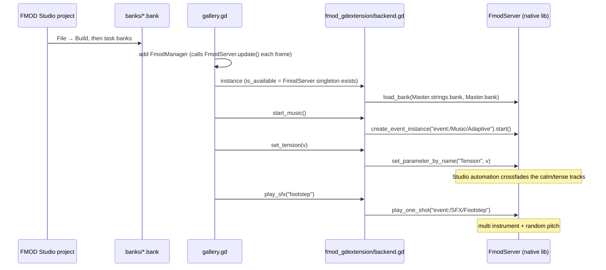

# FMOD gdextension (desktop)

`prototypes/fmod_gdextension/backend.gd` · run with `task fmod-gdextension`

This prototype runs FMOD Studio through [fmod-gdextension](https://github.com/utopia-rise/fmod-gdextension) (addon
6.1.0, FMOD runtime 2.03.6, in `addons/fmod/`). It is the **desktop reference**: the sound designer authors all adaptive
behaviour in FMOD Studio, and the game only starts events and sets parameters.

## How it works

## The adaptive part lives in FMOD Studio

- `event:/Music/Adaptive` has two audio tracks, `calm` and `tense`, inside one loop region. A **local** `Tension`
  parameter (continuous, 0–1) automates their volumes in opposite directions.
- `event:/SFX/Footstep` is a multi instrument over the four `back_00x` sounds with a random pitch modulator.
  `event:/SFX/Click` is a single sample (`click_001`), so the FMOD click has no variation, unlike the `godot_native`
  click.
- The `Tension` parameter has **no seek speed** set in the Studio project, so slider jumps snap instantly.
  `godot_native` fades at 2/s instead. To make the two match, set a seek speed in Studio and rebuild.
- To change the music behaviour, you edit the Studio project and rebuild. The game code stays the same. See
  the [bank guide](../fmod-studio-bank-guide.md).

## Results

- Verified by `task check`: banks built with Studio 2.03.15 load in runtime 2.03.6, all three event paths resolve, the
  music instance is valid, and `Tension` reads back as 0.7.
- Listening test: sound quality is good.

## Limitations

- **Desktop only.** The official Godot web templates have no GDExtension support. That is why the two web paths
  exist: [FMOD HTML5 SDK](fmod-html5.md) and the [engine module](fmod-engine-module.md).
- `FmodManager` is not an autoload, so web builds, which exclude the addon, still start. The gallery adds it when the
  `FmodServer` singleton is present.
