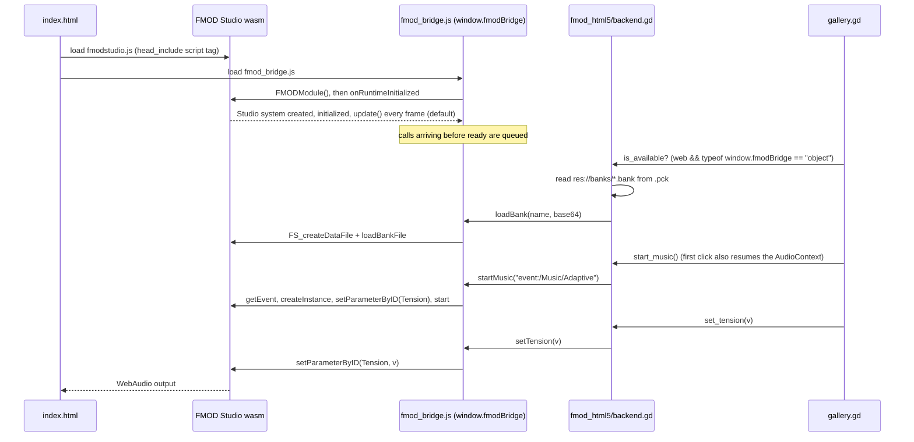
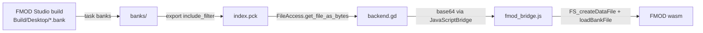

# FMOD HTML5 SDK + JavaScriptBridge (web)

`prototypes/fmod_html5/`

run with `task run:web:fmod-html5` (needs the SDK zip in `fmod/`)

This prototype loads FMOD's own HTML5 build of the Studio runtime (`fmodstudio.js` + `fmodstudio.wasm`, SDK 2.03.15)
into the page **next to** the Godot engine. GDScript calls it through `JavaScriptBridge`. The banks are the same desktop
banks the [gdextension prototype](fmod-gdextension.md) uses, so the sound design is identical on desktop and web.

## How it works

## Bank delivery

The banks travel **inside the `.pck`**: the "Web FMOD HTML5" preset sets `include_filter="banks/*.bank"`. GDScript reads
their bytes, base64-encodes them, and passes them across the bridge. The bridge decodes them into FMOD's in-memory file
system. Apart from the two SDK files and the bridge, nothing needs separate hosting.

## Files

| File                                      | Role                                                                                                                                                                              |
|-------------------------------------------|-----------------------------------------------------------------------------------------------------------------------------------------------------------------------------------|
| `backend.gd`                              | `AudioBackend` → `window.fmodBridge` calls                                                                                                                                        |
| `web/fmod_bridge.js`                      | Initializes FMOD (output at the driver's sample rate; DSP buffer and update cadence from the URL, see below), queues early calls, exposes `loadBank`, `startMusic`, `setTension`, `playOneShot`, `ready`, `lastError` |
| `export_presets.cfg` → "Web FMOD HTML5"   | Adds `<script>` tags through `html/head_include` and includes the banks                                                                                                           |
| `Taskfile.yaml` → `export:web-fmod-html5` | Exports, unzips `fmodstudio.js`/`.wasm` from the SDK, copies the bridge                                                                                                           |

## Latency settings (URL parameters)

FMOD's output buffer and the `System::update()` cadence can be changed per page load, so you can compare them by ear
in two tabs without rebuilding:

| Parameter | Values | Default |
|---|---|---|
| `fmod_buffer` | `<length>x<count>`, e.g. `1024x4`, `2048x2` | `512x4`, about 43 ms, the same as the desktop gdextension |
| `fmod_update` | milliseconds, or `frame` (requestAnimationFrame) | `frame` |

The defaults were 2048×2 (about 85 ms, the FMOD HTML5 docs' advice against WebAudio underruns) and 20 ms, and the
click and footstep lagged audibly behind the Godot-native version. In the listening test, 512×4 + `frame` sounded
better. The trade-off: FMOD and Godot share the browser's main thread here, so the buffer is the cushion against frame
stalls. About 43 ms covers 2–3 frames at 60 fps. If a heavier game shows dropouts during loads or on slow devices, try
`1024x4` first, then `2048x2`. In background tabs `frame` updates pause, so new commands wait until the tab is visible;
music that is already playing continues.

Example of the old, safer setting: `http://localhost:8060/?fmod_buffer=2048x2&fmod_update=20`. The values FMOD actually uses are printed to the browser console
and included in `describe()`, e.g. `dsp=512x4 (43 ms) rate=48000 update=every frame`. Invalid values fall back to the
defaults. Smaller buffers lower the latency, but can crackle on slow devices.

## Results

- Verified in headless Chromium (no audio output): FMOD initializes, and both banks load from the `.pck`. The official
  templates report "single-threaded, no GDExtension support", so this approach needs neither.
- Listening test in Firefox desktop: it works as well as the native FMOD prototype.
- Size (uncompressed): `index.wasm` 38.6 MB, `index.pck` 20.1 MB (includes the 5.5 MB bank), FMOD js+wasm 2.8 MB.

## Limitations

- Two runtimes share the page. Godot's audio and FMOD's audio are separate WebAudio graphs, so there is no shared bus or
  mix between them.
- Communication goes one way through string/number calls. Callbacks from FMOD back into GDScript, such as timeline
  markers or beats, would need `JavaScriptBridge.create_callback`. That isn't explored yet.
- The HTML5 runtime decodes only Vorbis, FADPCM, and PCM. Don't encode banks as Opus.
- The base64 copy temporarily doubles a bank's size in memory. That is fine for 5.5 MB, but worth revisiting for large
  banks: fetch them as separate files, or pass the bytes as a typed array.
- The FMOD HTML5 SDK can't be redistributed in this repo. Each developer downloads it.
