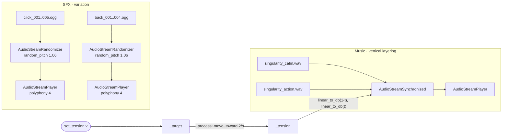

# Godot native (desktop + web)

`prototypes/godot_native/backend.gd`

run with `task run:godot-native` or `task run:web:godot-native`

This prototype rebuilds the FMOD demo with Godot's built-in audio only. It is the cheapest option and works on every export target, including the official web templates. It is the baseline the FMOD prototypes are measured against.

## How it works

- **Music:** `AudioStreamSynchronized` keeps both loops sample-aligned. `set_tension` only sets a target. `_process` moves the current value toward it at 2 units/s, which emulates FMOD's parameter seek speed so slider jumps fade instead of snapping. The volumes form a linear crossfade in amplitude.
- **SFX:** `AudioStreamRandomizer` picks a variation and randomizes pitch by about ±1 semitone (`random_pitch = 1.06`). `max_polyphony = 4` lets quick repeats overlap. `footstep` uses the Kenney "back" UI sounds as a stand-in.

## Results

- Verified by `task check`: the music plays and loops (`LOOP_FORWARD`). At Tension 0.7 the calm layer sits at -10.5 dB and the action layer at -3.1 dB.
- Listening test in Firefox desktop: sound quality is good.
- Web build: no threads, no extensions, `addons/fmod/*` and `banks/*` excluded. `index.wasm` 38.6 MB, `index.pck` 14.6 MB (uncompressed).

## Limitations

- The adaptive logic is code, not authored content. Every new behavior, such as curves, transitions, or stingers, has to be programmed.
- For horizontal re-sequencing (switching sections on bar boundaries), Godot has `AudioStreamInteractive` with transition tables. This gallery doesn't demo it yet. It would be the natural next native prototype.
